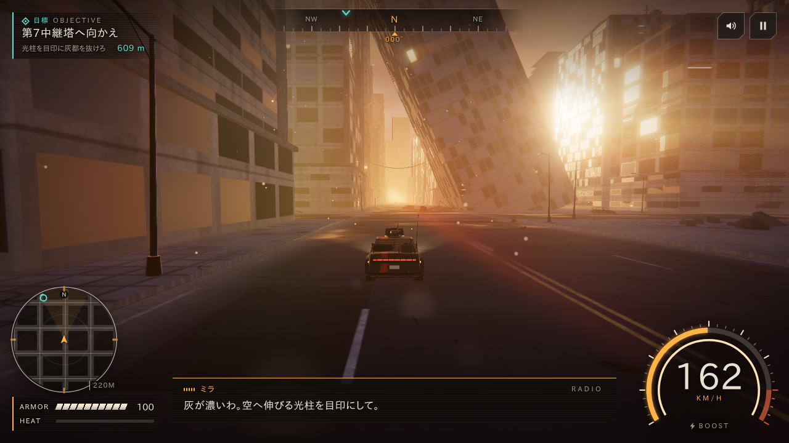
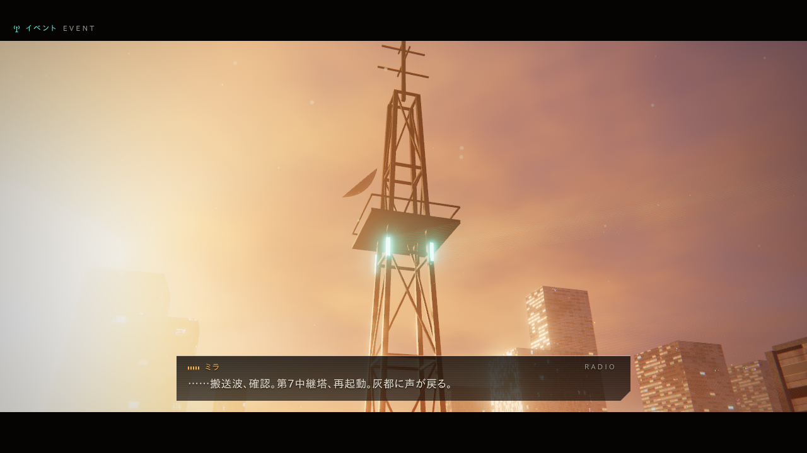
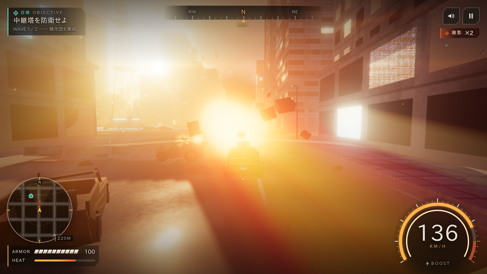
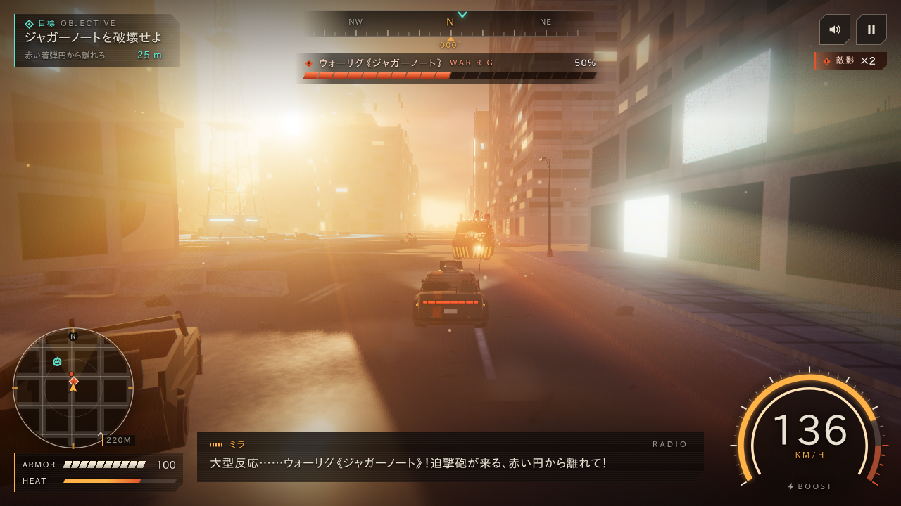
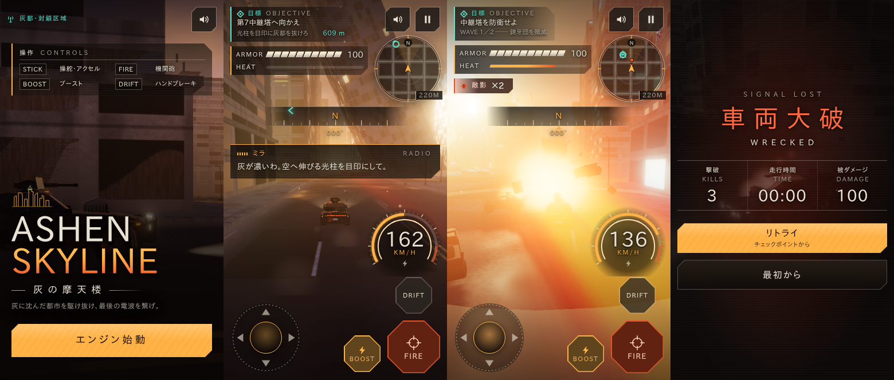
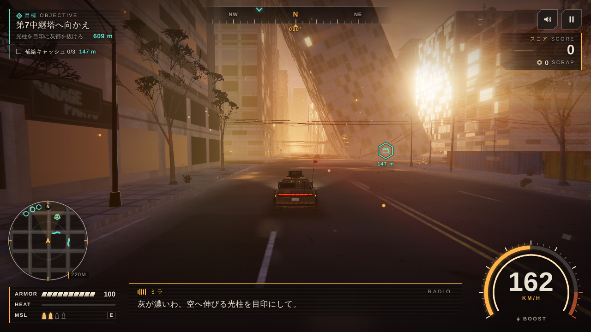
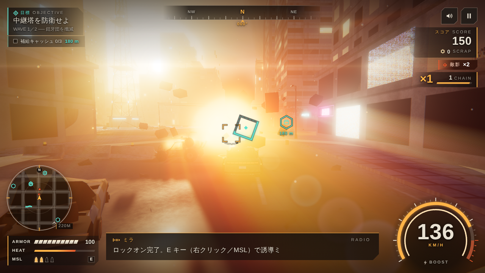

# 検証記録（pass-1）

対象コミット: `8622532`（キャプチャ時点）。モバイルの影負荷削減のみ、その後のコミットで追加。
実行環境: クラウドコンテナ、Chromium + SwiftShader（**ソフトウェア描画**）。このため **FPS・フレーム時間は計測していない**（1フレーム 1〜2 秒）。ピクセル指標と描画数のみ有効。

## 実行したもの

| 種別 | コマンド／手段 | 結果 |
| --- | --- | --- |
| 型チェック＋本番ビルド | `npm run build` | 成功。JS 807 kB（gzip 223 kB）、CSS 34 kB |
| キャンバス検査（14件） | `scripts/inspect-threejs-canvas.mjs --manifest artifacts/evidence.json --seed 42`（本番プレビューに対して） | 14/14 PASS、コンソールエラー 0、ページエラー 0 |
| 証跡チェック | `check_evidence.py . --manifest artifacts/evidence.json` | `Evidence check passed: 14 artifact(s) confirmed.` |
| 実入力 | Playwright で開始ボタン・W・D・Space・Esc を送出 | 開始→`drive`、W で +Z へ加速、D で右旋回、Space で砲身熱が上昇、Esc でポーズ／再開 |
| ボット通しプレイ | `advance` フックで 0.1 秒刻みに操舵を決めるボット（障害物回避つき） | 下表 |
| 勝利経路 | `boss-final` 状態（ボス残り 5%）から実ダメージで撃破 | `battle/boss` → `victory` → `complete`、Enter で再スタート |
| デプロイ | GitHub Actions `Deploy to GitHub Pages` | build / deploy とも success |

### ボット通しプレイ（最終調整後、seed 7）

| 時刻(s) | 進行 | 装甲 | 撃破 |
| --- | --- | --- | --- |
| 0 | 出発（中継塔まで 892 m） | 100 | 0 |
| 12.1 | 斥候が出現 | — | — |
| 45.9 | イベント開始（塔まで 36 m） | 86 | 1 |
| 61.4 | WAVE 1 開始 | 86 | 1 |
| 76.3 | WAVE 2 開始 | 100 | 4 |
| 113.9 | ボス開始 | 98 | 8 |
| 145.0 | 大破（ボス残り 88%）→ Enter でボス戦先頭へ復帰（装甲 100） | 0 | 10 |

- リトライは3回とも `battle/boss`・装甲 100 で復帰することを確認。
- **このボットはボスを倒せていない**（3回とも 30〜45 秒で大破、ボス体力は最大 12% 減）。ボットは迫撃砲の着弾円を見ておらず随伴車を優先するため。その後ボスを緩和（体力 1250→1000、砲撃間隔と精度を緩和）したが、**人間によるボス戦の難度は未検証**。
- 被ダメージ内訳（ボス戦1回目まで）: 銃撃 84／体当たり 31／迫撃砲 57／壁 9。

## ピクセル指標（検査ツール実測）

| ビュー | 状態 | 色エントロピー | エッジ密度 | 輝度コントラスト | 支配色比率 |
| --- | --- | --- | --- | --- | --- |
| desktop 1280×720 | title | 4.25 | 0.166 | 159.6 | 0.211 |
| desktop | active-play | 5.71 | 0.241 | 167.8 | 0.098 |
| desktop | event | 5.61 | 0.116 | 220.9 | 0.189 |
| desktop | battle | 7.71 | 0.198 | 209.5 | 0.031 |
| desktop | boss | 7.08 | 0.245 | 209.6 | 0.060 |
| desktop | failed | 3.19 | 0.052 | 27.3 | 0.303 |
| desktop | complete | 3.65 | 0.131 | 53.0 | 0.309 |
| mobile 390×664 | title | 4.03 | 0.221 | 184.2 | 0.305 |
| mobile | active-play | 5.46 | 0.306 | 160.5 | 0.144 |
| mobile | event | 5.42 | 0.192 | 179.4 | 0.148 |
| mobile | battle | 7.42 | 0.260 | 196.3 | 0.024 |
| mobile | boss | 6.67 | 0.342 | 190.8 | 0.067 |
| mobile | failed | 3.53 | 0.139 | 179.5 | 0.295 |
| mobile | complete | 3.92 | 0.173 | 175.1 | 0.299 |

`failed` / `complete`（desktop）のコントラストが低いのは、結果画面が全面の暗いオーバーレイで覆う設計のため。

## 描画予算（最悪ビュー）

| 指標 | desktop 実測 | 目安 | mobile 実測 | 目安 |
| --- | --- | --- | --- | --- |
| ドローコール | 138（battle） | ≤300 | 123（boss） | ≤150 |
| 三角形（影パス込み） | 627k | ≤750k | 626k → 影削減後 466k（battle 再計測） | ≤300k **超過** |
| ジオメトリ | 67 | ≤300 | 63 | ≤200 |
| テクスチャ | 21 | ≤60 | 21 | ≤40 |
| 影つきライト／影マップ | 1／2048 | ≤2／≤2048 | 1／1024 | 1／≤1024 |
| ポストパス | 2（フォグ、ブルーム）＋最終合成 | ≤2 | 同左 | 0〜1 **超過** |
| DPR 上限 | 1.5 | 2 | 1.25 | 1.5〜2 |

モバイルの超過（三角形・ポストパス）は意図したトレードオフ：大気フォグと光条が画づくりの中核のため残した。代わりに影マップ半減、MSAA 無効、光条サンプル数削減、小物の影省略、フレーム時間に応じた自動解像度低下（最小 55%）を入れている。**実機での動作速度は未計測**。

## ビジュアルスコアカード（自己採点、基準画像 scene-1〜3 と照合）

| カテゴリ | 前 | 後 | 根拠 |
| --- | --- | --- | --- |
| アートディレクション | 未取得 | 2.5 | 夕陽・灰・琥珀の配色が空、フォグ、HUD、無線まで一貫 |
| 主役（車両） | 未取得 | 2 | 押し出し形状の車体、砲塔、排気、灯火、損傷で焦げる塗装。側面は平坦 |
| 敵 | 未取得 | 2 | バギー3種とウォーリグでシルエットが別、攻撃前にアクセント灯が発光 |
| インタラクト対象 | 未取得 | 2 | 中継塔（起動で赤→青緑）、光柱、迫撃砲の着弾円 |
| 世界 | 未取得 | 2.5 | 倒壊タワー、崩落高架、廃墟の骨組み、残骸、街灯、ケーブル、遠景 |
| マテリアル | 未取得 | 2 | 窓・割れ・煤・水たまり・路面標示をシェーダーで生成。テクスチャ解像の質感は限定的 |
| ライティング／描画 | 未取得 | 2.5 | 低い太陽＋環境光、高さフォグ、光条、ACES。輝度コントラスト 160〜220 |
| VFX | 未取得 | 2 | 曳光弾、火花、爆発、衝撃波、破片、焦げ跡、排気炎、降灰 |
| UI／HUD | 未取得 | 2.5 | 計器クラスタ、コンパス、ミニマップ、無線、各画面、タッチ操作 |
| 性能の証跡 | 未取得 | 2 | 描画数・ビルド・両ビューポート検査あり。実 GPU の FPS なし |

平均 **2.2**。全カテゴリ 2 以上だが、スキルの「Premium」基準（平均 2.3 以上）には **0.1 届いていない**。次に効くのは、主役車の側面造形と、実 GPU での FPS 計測。

## 未検証・既知の制約

- 実 GPU・実機（PC／スマートフォン）での FPS と操作感。
- 音：音量レベルの計測のみで、耳での確認はしていない。
- 人間によるボス戦の難度。
- 公開 URL への到達確認（コンテナのネットワーク制限で `github.io` に接続不可。デプロイジョブの成功のみ確認）。
- `tests/visual.spec.ts`：新しいゲームに合わせて書き換えたが、この環境にはプロジェクト固定の Playwright に合うブラウザが無く未実行。
- 残骸に高速で当たると全停止する（すり抜け・弾き飛ばしは未実装）。

## スクリーンショット

## 追記：実GPUで3Dが真っ黒になる不具合（pass-1 後に修正）

- 症状：公開版でHUDは出るが3D描画が真っ黒（ユーザー報告、実GPUのブラウザ）。
- 再現：空のシェーダーへ意図的に NaN を注入すると、ソフトウェア描画でも画面全体がほぼ黒（最大輝度 11/255）になった。NaN の1画素がブルームのぼかしで全面へ広がるため。
- 修正：(1) ブルーム前段のフォグパスで NaN／Inf を除去しクランプ、(2) `pow` の底を全てクランプ（太陽の真逆方向で負になり得た方位項など）、(3) 空ドームを遠方クリップ面のわずか手前に配置。
- 確認：NaN 注入を残したままでも正常描画（最大輝度 217/255）に戻ることを確認後、注入を除去。
- 保険：描画結果が黒い場合に自動で段階的に簡易化する仕組みを追加（1: MSAA 無効 → 2: ブルーム無効 → 3: 素の描画）。`?debugBlack=1` で強制的に黒くし、レベル3まで進んで画面が回復することを確認。現在のレベルは `__THREE_GAME_DIAGNOSTICS__.renderer.safeLevel`、手動指定は `?safe=1..3`。
- **未確認**：実GPUでの表示。この環境にはGPUが無く、実GPUでの真因が上記の NaN であることは推定（症状の一致と再現に基づく）。

## 追記：AAA 化改修（pass-2）

実機プレイのフィードバック（フレームレート・モバイル負荷・ボス難度は問題なし／音が小さく少ない／ゲーム性が少ない）を受けた改修。

| 領域 | 内容 | 検証 |
| --- | --- | --- |
| ゲーム性 | 誘導ミサイル、物資回収、爆発ドラム缶、巡回部隊、補給キャッシュ、スコア／コンボ／スタイル、強化選択、ランク、エンドレス | 機能別ボットで数値確認（回収・ロックオン撃破・誘爆・キャッシュ開封→強化適用・コンボ・ドリフト・ニアミス・リトライ） |
| 音 | 全体音量の引き上げ（戦闘曲 RMS 0.05→0.14〜0.18、機関砲ピーク 0.36→0.57〜0.78）、効果音21種追加、敵エンジン音、戦況連動の音楽、リミッター | 出力レベルの計測のみ。最大 \|0.904\|。**耳での確認はしていない** |
| HUD | スコア、コンボ、ミサイル残弾、ロックオン照準、サイド目標、強化選択画面、ランク表示、MISSILE タッチボタン | 4画面サイズ×14場面を撮影、操作をプログラムで確認 |
| 車両 | 主役車を断面ロフト形状に作り直し（内装・半透明ガラス・損傷表現）、バギー3種・ウォーリグ・残骸5種を刷新 | ビューアと実ゲームで撮影。主役車 17 ドローコール／19k 三角形 |
| 街 | 信号機、標識、放置バス・トラック、コンテナ、検問、足場、枯れ木、雑草、路面デカール、ネオン、煙、カラスなど | デスクトップ +21 ドローコール／+21万三角形、低スペック +21／+10万 |
| 描画 | レンズフレア、演出時の被写界深度、車両の接地影、スキッド痕 | 統合版を title / active-play / battle / boss で撮影、黒画面検出は全て正常（safeLevel 0） |

統合版のボット通しプレイ（seed 11・直行）：最初の敵 11.3 秒 → イベント → WAVE 1・2 → ボス到達。**このボットはボスに5回敗北**（最良でボス残り 5%）。ゲームプレイ単体の検証では3回中2回クリア（ランク B）。コンソールエラーは 0。

未検証：実 GPU での改修後の表示・速度、タッチでのミサイル操作、エンドレスの4ウェーブ目以降（テスト状態でのみ確認）、音の聴感。既知の弱点：縦書きネオンの文字が判読しづらい、残骸の新2種（バン・バス前部）は街に未配置、チェイスカメラでは主役車の改良が見えにくい。

